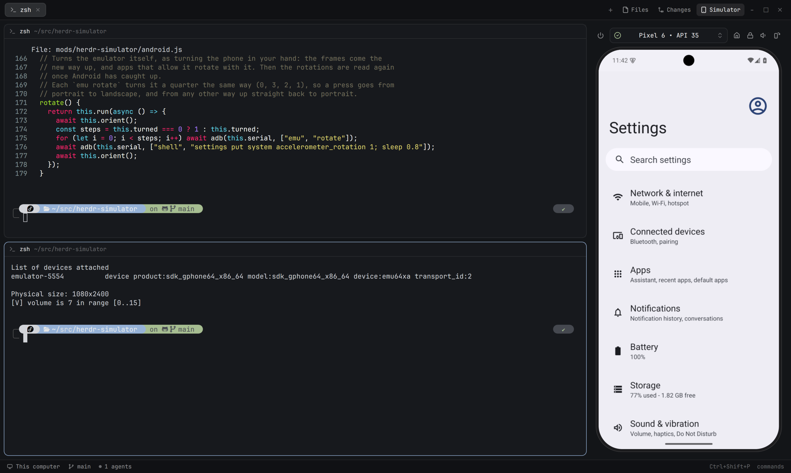

# Herdr Emulator

Your iOS simulator and Android emulator, live inside [Herdr](https://herdr.dev), next to your code and terminals. Android works on Linux and macOS; iOS needs macOS.



Pick any simulator or emulator on your machine and use it right in Herdr. Run your mobile tests and watch them tap through the app while the results print beside it.

This is a fork of [wobsoriano/herdr-sim](https://github.com/wobsoriano/herdr-sim) that adds Linux support for Android, smoother frames, real rotation, a Stop button and a few toolbar changes. See [What's different here](#whats-different-here).

## What you can do

- **See the device live.** The screen updates up to about 45 times a second, as fast as the emulator sends it, and nothing is redrawn while the screen is still.
- **Use it in place.** Click to tap, drag to swipe, scroll with your mouse or trackpad, and type with your keyboard.
- **Press its buttons.** One row above the screen holds Stop, the device picker, then Home, Lock, Volume and Rotate, and on iOS the on-screen keyboard.
  - **Volume** is one button: click or scroll up to raise it, right-click or scroll down to lower it. On Android its icon shows the level: muted, low, mid or high.
  - **Rotate** turns the device: on Android between portrait and landscape, on iOS a quarter turn each press. Its icon is a phone drawn the way the device is held now.
  - **Stop** shuts the device down. Pick it again to boot it.
- **Switch devices.** The picker lists every iOS simulator and Android emulator on your machine, with the running ones marked green. Pick one that's off and it starts. Android emulators run without a window of their own.
- **Show two at once.** Each panel and pane has its own device, so an iPhone and an Android emulator can run side by side. A new pane starts on the device you picked last.
- **Put it where you want it.** Open it from a Simulator button in the tab bar, next to Files and Changes, or as a pane in any layout.
- **Fix stuck taps.** On Xcode 27, taps on a simulator sometimes stop working. Repair input in the picker fixes them. It restarts SpringBoard, so open apps close.

## Install

Ask your Herdr agent to "add the layout at github.com/alok-debnath/herdr-emulator".

Or by hand:

```sh
git clone https://github.com/alok-debnath/herdr-emulator
cd herdr-emulator
cp -R mods/herdr-emulator mods/herdr-emulator-screen mods/tabs-herdr-emulator ~/.config/herdr-app/mods/
cp layouts/herdr-emulator.json ~/.config/herdr-app/layouts/
herdr-app do layout.switch --name herdr-emulator
```

Then add the two shortcuts in [keys.json](keys.json) to `~/.config/herdr-app/keys.json`. In Herdr, the layout and the mod are both named `herdr-emulator`.

If you only want the pane, copy `mods/herdr-emulator` and `mods/herdr-emulator-screen` and skip the rest. To add the Simulator to a layout of your own, put the `herdr-emulator` block from `layouts/herdr-emulator.json` in its `panel-body` stack and use `tabs-herdr-emulator` for its tab bar.

Install by copying, not by linking: Herdr loads a linked mod's code but not its icons.

### What you need

- **Android, on Linux or macOS:** the Android SDK with at least one emulator image built for your machine's CPU, Node, and `nc`. The SDK is found from `ANDROID_HOME`, then `ANDROID_SDK_ROOT`, then `~/Android/Sdk` (Linux) or `~/Library/Android/sdk` (macOS), so Herdr doesn't need `ANDROID_HOME` set.
- **iOS, on macOS:** Xcode with at least one simulator, and Node.

## Use it

### From the tab bar

Switch to the `herdr-emulator` layout. Click **Simulator** next to Files and Changes, or press ⌘⇧S (Super+Shift+S on Linux). Click it again to close the panel. Each space remembers whether the panel was open.

### As a pane

In any other layout, press ⌘⇧S, or run:

```sh
herdr-app do pane.split --direction right --mod herdr-emulator
```

Close it like any other pane.

## What it runs on your machine

Herdr Emulator sends nothing over the internet itself.

- For iOS it runs Xcode's simulator tools and [serve-sim](https://github.com/EvanBacon/serve-sim), which downloads from npm the first time.
- For Android it runs `adb` and the emulator from your Android SDK, plus a small helper that comes with the mod. The helper reads the emulator's screen over its local gRPC port and serves it on `127.0.0.1`.
- It saves the latest frames of the screen as image files in its own folder, because Herdr shows pictures from files.
- On Android it turns on auto-rotate, so apps turn with the device.

## Limits

- The picture is about 0.12 seconds behind the device, because Herdr takes about that long to show a changed image. Taps and typing reach the device right away.
- On Android, apps that lock themselves to portrait, the home screen among them, show sideways in landscape, as they would on a phone you turned.
- Volume levels are shown on Android only. On iOS the button keeps one icon.
- Tested with Herdr 0.1.16 and the Android emulator on Linux (x86_64). The iOS path is unchanged from the original, which was tested with Herdr 0.1.13 and Xcode 27.
- The Simulator button lives in a copy of Herdr 0.1.16's tab bar. If a Herdr update changes the tab bar, this copy keeps the old one until it's updated here.
- Showing an iPhone takes about 175 MB of memory.

## What's different here

Changes from [wobsoriano/herdr-sim](https://github.com/wobsoriano/herdr-sim):

- **Android on Linux.** The SDK falls back to `~/Android/Sdk`, the helper finds the running emulator under `$XDG_RUNTIME_DIR/avd/running`, and iOS is only listed on macOS, so a missing `xcrun` doesn't hide the Android devices.
- **Android frames show.** The helper used Node's `http` server, whose chunked encoding put chunk sizes inside every frame, so no frame was a valid image. It now writes the stream to the socket directly.
- **Smoother and lighter.** A still screen sends nothing (identical frames are skipped), frames are written up to 50 times a second instead of 30, and each shows after 120 ms instead of 200.
- **Real rotation on Android.** Rotate turns the emulator itself, so frames come the right way up and sharp both ways (540×1200 or 1200×540). Taps are mapped through both how the device is held and how the app is drawn, so they land in portrait-locked apps too.
- **Stop button**, **one Volume button** with a level icon, and a **Rotate icon** that shows the orientation.
- **More room for the screen.** One 32px row for the picker and buttons, thinner padding and bezel, and a 410px panel.
- **Tab bar rebuilt** from Herdr 0.1.16's, so tab titles and wheel scrolling match current Herdr.

## License

MIT, see [LICENSE](LICENSE). The tab bar in `mods/tabs-herdr-emulator` is adapted from Herdr's own and keeps Herdr's Apache-2.0 license, in `mods/tabs-herdr-emulator/LICENSE`. The icons are from [Lucide](https://lucide.dev) under the ISC license, except the Android icon and the two phone icons for Rotate, which were drawn for this mod in Lucide's style.
