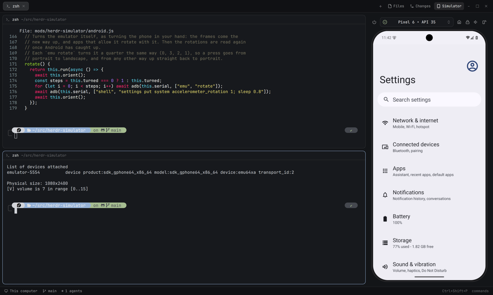

# Herdr Emulator

Herdr's main window with a live phone in it: a **Simulator** button after Files
and Changes opens the picked iOS simulator or Android emulator in the
right-hand panel, where the person taps, swipes and types on it while their
code and tests run beside it. The same view opens as a pane in any layout.
Android works on Linux and macOS; iOS needs macOS.

## What you see

- **Everything of Herdr's `main` layout** (sidebar, tab bar, panes, status
  bar), with one more button in the tab bar: **Simulator**, a 14px
  `smartphone` icon and the label, after Files and Changes, styled like them
  (26px tall, 6px radius, `selected` background while its panel shows).
- **The panel** (410px wide by default, 280 to 900px) shows the `herdr-emulator`
  view, top to bottom, with 8px padding and an 8px gap:
  - **One 32px row**: at the left a 26px **Stop** button (14px `power` icon,
    `ansi1` red on hover), then the **device selector** filling the row (32px
    tall, 8px radius, `surface` background, 1px `border` border, `input` on
    hover): a 15px `circle-check` icon (`ansi2` green while streaming,
    `blocked` on an error, `dim` otherwise), the centered 13px text
    `iPhone 17 • iOS 27.2` or `Pixel 6 • API 35` (the selector drops
    "Android"), or `Select device`, and a 14px `chevrons-up-down` icon. Then
    26px icon buttons (14px icons, `muted`, `hover` background, half opacity
    until the device is live): Home (`house`), Lock (`lock`), **Volume** and
    **Rotate**, and on iOS only Keyboard (`keyboard`). Each has a tooltip.
  - **Volume's icon is the device's level** on Android: `volume-x` muted (0),
    `volume` up to a third, `volume-1` up to two thirds, `volume-2` above;
    the tooltip reads `Volume 7/15: click or scroll up to raise, right-click
    or scroll down to lower` (or `Volume muted: …`). On iOS it stays
    `volume-2` with `Volume: …`.
  - **Rotate's icon is a phone the way the device is held**: `phone-portrait`
    (an upright phone, arrow at the top right) or `phone-landscape` (a phone
    on its side, arrow at the top left), from the frame's aspect. Tooltip
    `Rotate to landscape` or `Rotate to portrait`. Both icons are drawn for
    this mod in Lucide's style (24 box, stroke 2, round caps).
  - **The phone**, centered in the rest: a `#1c1c1e` bezel with a 1px
    `#3a3a3c` border and 5px padding around the screen. The screen keeps the
    frame's aspect ratio, fills the height or width it can, and has corners
    of 13% of its **shorter** side (bezel corners 5px more), so landscape
    keeps a phone's corners.
- **Instead of the screen**, a black rounded rectangle with one 12px `dim`
  line while there's no picture: `Connecting to iPhone 17…`, `Booting Pixel 6…`,
  `Stopping Pixel 6…`, `iPhone 17 is shut down. Pick it again to boot it.`,
  `Pick a device above`, `Repairing input on iPhone 17. SpringBoard restarts
  and apps close.`, or an error's message.
- **The device menu** drops from the row over the view (8px radius,
  `popover` background, `border` border, medium shadow): an 11px `dim` heading
  per platform, Android first, then iOS (macOS only); per device a 15px
  `android` or `apple` icon, the 13px name, a 7px `ansi2` dot when it's
  running (or `booting`), an 11px `dim` OS line, and a 14px check on the
  selected one (`selected` background). Images the machine can't run show at
  half opacity with `x86 image, can't run on this machine` and can't be
  picked. With no devices: `No simulators or emulators. Create one in Android
  Studio.` For a running iOS simulator, a divider and **Repair input** with
  `restarts SpringBoard` on the right close the menu.

## How it behaves

- **Simulator button / ⌘⇧S** (in the `herdr-emulator` layout): opens the panel on
  `herdr-emulator`, or closes it when it already shows it. Like Files and Changes, the
  panel's state is remembered per space.
- **⌘⇧S in any other layout** splits the focused pane with a `herdr-emulator` pane.
  (`cmd` is Super on Linux.)
- **While the panel is closed** or showing Files or Changes, its view stops
  streaming and picks up within a second of showing again. Panes always
  stream, since a pane can't tell whether its tab shows.
- **Picking a device** changes only that view. Each view (the panel, each
  pane) keeps its own choice in shared state; a view with none shows the
  device picked last anywhere at the moment it opened. A shut-down one boots:
  iOS with `simctl boot`, Android with the emulator, headless (`-no-window
  -no-audio`). With nothing picked, the first running device shows.
- **Stop** ends the stream, then shuts the device down: Android with
  `adb -s <serial> emu kill`, iOS with `simctl shutdown` (after killing its
  serve-sim). The view shows `Stopping …` until the list stops calling it
  booted, then `… is shut down. Pick it again to boot it.` Stop is disabled
  while no device runs.
- **Volume**: click or wheel up presses volume up, right-click or wheel down
  volume down; a mouse wheel is one step per line, a touchpad one per 20px.
  On Android the level is read after every press, when the stream starts,
  and every 5 seconds while live (changes made on the device show too), with
  `cmd media_session volume --stream 3 --get`. Android's first press after a
  pause only shows its volume panel.
- **Rotate** on Android turns the emulator itself (`adb emu rotate`, a
  quarter turn each), with `accelerometer_rotation` set to 1 so apps follow
  it: from portrait one turn to landscape, from any other way up as many
  turns as bring it back to portrait. On iOS it is serve-sim's rotation
  (Simulator.app's Rotate Left order).
- **On the screen**: press, drag and release are one finger (begin, move, end),
  in fractions of the screen; the scroll wheel scrolls; keys go to the device
  while the view has focus (it takes focus on a click), with their modifiers.
  The toolbar buttons press the device's buttons.
- **Repair input** (iOS) runs `serve-sim repair-input`, then restarts the
  stream; for when taps do nothing because Xcode's Device Hub took input.

## Built from

- **Layout** `layouts/herdr-emulator.json`: a clone of Herdr 0.1.16's `main`.
  `tabs` uses `tabs-herdr-emulator`; the `panel` column is 410px; the `panel-body`
  stack holds `files`, `changes` and a third block `{ "id": "herdr-emulator",
  "content": { "mod": "herdr-emulator", "props": { "frames": "panel" } } }`.
- **`mods/tabs-herdr-emulator`**: Herdr 0.1.16's `tabs` mod cloned (`mod.clone`),
  with `nextCommand` imported, `"herdr-emulator"` appended to the enabled panels,
  the Simulator `panelButton` after Changes, and a `togglePanel(id)` the
  buttons and a `nextCommand()` loop started in `init` share (so
  `"tabs-herdr-emulator.herdr-emulator"` in `keys.json` toggles it).
- **`mods/herdr-emulator`** (`"focusable": true`): `main.js` (picker, session loop,
  frame ring, input, render), `serve-sim.js` (iOS), `android.js` (Android input,
  rotation, volume and helper start), `android-stream.mjs` (the Android frame
  helper), `icons/`.
  - A session is `{ device, input, host, port, path }`: a multipart stream of
    frames on localhost plus an input object with `touch`, `key`, `button`,
    `hid`, `scroll`, `rotate` (and `softwareKeyboard` on iOS; `volume` and
    `orient` on Android). One `stream()` reader handles both platforms.
  - Each platform in `PLATFORMS` has `list`, `boot`, `stop` and `start`. iOS
    is listed only when `window().platform` is `macos`.
  - **iOS**: `serve-sim@0.1.49` through `$SHELL -lic 'npx --yes …'` with
    `SERVE_SIM_DISABLE_DEVICE_HUB_KEYBOARD=1`; frames from
    `/helper/<udid>/stream.mjpeg` over `net.connect`; input over its `/ws`
    socket as `[tag][JSON]` (0x03 touch, 0x04 button, 0x06 key, 0x0b scroll,
    0x0c software keyboard), HID volume, and `/config` for rotation.
  - **Android SDK**: `sdk="${ANDROID_HOME:-${ANDROID_SDK_ROOT:-}}"`, else
    `~/Android/Sdk` if it exists, else `~/Library/Android/sdk`. Herdr started
    from a desktop launcher often has no `ANDROID_HOME`.
  - **Android input**: `adb shell input motionevent DOWN/MOVE/UP` (moves
    coalesced), `keyevent`, `keycombination` for Shift, `swipe` for the wheel.
    Points go frame → panel → display: `turned` is `mProposedRotation` (how
    the emulator is held, which is how the frames come) and `display` is
    `mCurrentRotation` (how the app on screen is drawn), both from one
    `dumpsys window displays | grep` (~16 ms), read when the session starts,
    after every touch end, after a rotation, and when the frame's aspect flips.
    A frame point is turned back to the native portrait panel by `turned`,
    then into display coordinates by `display`, Android's convention
    (`ROTATION_90` is `(y, W - x)`), so taps land in portrait-locked apps on a
    landscape device too.
  - **Android frames**: `android-stream.mjs` calls
    `EmulatorController/streamScreenshot` on the emulator's gRPC port with
    `node:http2` (ImageFormat PNG, width and height both `round(540 × 20 / 9)`
    = 1200: a square box, so frames are 540×1200 in portrait and 1200×540 in
    landscape; both must be set or the size is ignored), with the `Bearer`
    token from the emulator's discovery `.ini`, looked for under
    `~/Library/Caches/TemporaryItems/avd/running` (macOS),
    `$XDG_RUNTIME_DIR/avd/running`, `/run/user/<uid>/avd/running` and
    `<tmpdir>/android-<user>/avd/running` (Linux). A frame identical to the
    last is dropped. It serves the PNGs as `multipart/x-mixed-replace` on
    `27000 + console port` from a `node:net` server writing the response
    itself (status line, headers, then one `--frame` part per write), and
    replays the last frame to each new viewer; a viewer whose socket still
    has unsent bytes skips that frame. The mod starts it in `sh` only when
    `nc -z` finds nothing on that port, then waits with `nc -z`.
  - **Views**: the panel is `props.frames` (`"panel"`); a pane claims the
    lowest free `pane-N` from a `Set` on `globalThis` (shared by every copy,
    empty when Herdr starts) and frees it in `close()`. Choices live in shared
    `herdr-emulator.devices` keyed by view, plus `herdr-emulator.device` for the last pick.
  - **Frames on screen**: each frame is written to the next of 12 files in
    `mods/herdr-emulator-screen/<view>-<n>.jpg` and moved to the top of a stack of
    12 absolutely placed `image()`s 120 ms later (`RELOAD_MS`); at most one
    write per 20 ms (`FRAME_MS`) on a due-time schedule.
- **`mods/herdr-emulator-screen`**: an empty mod (`main.js` renders a `div()`) whose
  folder holds the frames.
- Herdr functions: `exec`, `net.connect`, `writeFile`, `appHome`, `shared` /
  `setShared`, `props`, `nextCommand`, `theme`, `layout`, `window`, `run`
  (`layout.select`, `layout.show`, `layout.hide`).

## Watch out

- **Don't serve the frames with `node:http`.** Without a `Content-Length` it
  answers HTTP/1.1 with chunked encoding, and the chunk sizes land inside
  every frame the mod cuts out by `Content-Length`: each file starts with
  `\r\n`, no frame decodes, and the screen stays blank while the view says
  live.
- **Frames must live in another mod's folder.** Herdr refreshes an image under
  `mods/` when its file changes, but writing inside the mod's own folder
  reloads the mod.
- **A changed image shows ~100 ms later, blank in between.** Rewriting one
  file flickers; hence the ring of files and the delayed reveal. Measured on
  Linux with Herdr 0.1.16: at 50 ms the view jumps back to older frames, at
  100 ms and up it doesn't, so 120 ms. A ring must outlast `RELOAD_MS` plus
  one frame on show: `(RING - 1) * FRAME_MS` > `RELOAD_MS`.
- **Don't use a new path per frame**: Herdr's image cache never evicts, so it
  grows by megabytes a second. `http://` paths don't load in `image()`.
- **Gate frames on a schedule**, not "20 ms since the last write": frames
  arrive unevenly, and the gap rule drops two where it should drop one.
- **Each view needs its own frame files**, or two views overwrite each other's
  frame on show. A mod pane can't learn its own pane id (its `props()` hold
  only what it was opened with, and `panes()` lists terminal panes only), and a
  fresh id per pane would leak decoded images, so panes reuse `pane-N` slots.
  Saving a mod file reloads every copy without `close()`, so a reload takes
  new slots and the old ones (and their device choices) stay taken until
  Herdr restarts. Read props with `props()` from `herdr`; `init`'s first
  argument is empty here.
- **Rotating Android through `user_rotation` doesn't work.** It turns the
  display inside a portrait framebuffer, so the frames show the app sideways.
  The gRPC `ImageFormat.rotation` field doesn't rotate the frames either.
  Turn the emulator (`emu rotate`) and keep `accelerometer_rotation` on.
- **A muted media stream reads 0 and ignores the keys.** `Muted: true` in
  `dumpsys audio` pins `STREAM_MUSIC` at 0; `cmd audio adj-unmute 3` clears
  it. The mod shows it as muted and doesn't change it.
- **Herdr's `PATH` can find a broken `node`**: start serve-sim and the helper
  through `$SHELL -lic`. Mods have no `setTimeout`; wait in `sh` instead.
- **`serve-sim --list -q` ignores its UDID**: match the running stream's
  `device` yourself.
- **Xcode 27**: without `SERVE_SIM_DISABLE_DEVICE_HUB_KEYBOARD=1` keys only
  arrive while Device Hub is frontmost; when
  `com.apple.coredevice.dtuhidd.active` is 1, taps do nothing until
  `serve-sim repair-input`.
- **Copies keep running while hidden.** Once shown, a copy stays alive while
  its block is in the layout, so the panel checks `layout()` (the `panel`
  column's `hidden`, `panel-body`'s `active`) and stops reading frames. The
  Android helper exits meanwhile, so reopening starts it again before reading.
- **Emulator images must match the host's CPU** (`uname -m`); list the others,
  don't boot them.
- `herdr-app shot` runs on Herdr's main thread (~40 ms each): sampling faster
  than ~5 per second starves the view you're measuring.

## Done when

- The `herdr-emulator` layout shows a Simulator button after Changes; clicking it opens
  the panel with the device streaming, and clicking again closes it.
- On Linux, with Herdr started without `ANDROID_HOME`, the picker lists the
  Android emulators and a running one streams.
- Every frame file is a valid PNG, and a still screen writes no new frames.
- Dragging a list in the panel scrolls it on the device, smoothly (about 45
  distinct frames a second on Android), with no blank frames and no jumps back.
- Rotate turns an Android emulator to landscape with 1200×540 frames and
  phone-shaped corners, and back to portrait on the next press; its icon
  follows. A tap on a landscape app and on the sideways home screen both
  open what's under the pointer.
- Volume's icon matches the device's level (set it with `cmd media_session
  volume --stream 3 --set N` and it follows within 5 seconds).
- Stop shuts the device down and the view says so; picking it again boots it.
- Typing into a focused text field types on the device, Shift included.
- The picker lists iOS (on macOS) and Android devices under their headings;
  picking the other platform switches the stream within a few seconds, and an
  Android helper process exits a few seconds after the view leaves it.
- `herdr-app do pane.split --direction right --mod herdr-emulator` opens the same view
  in a layout without the panel, while the panel shows too, both live.
- Two panes can show an iPhone and an Android emulator at once, and picking in
  one leaves the other.
